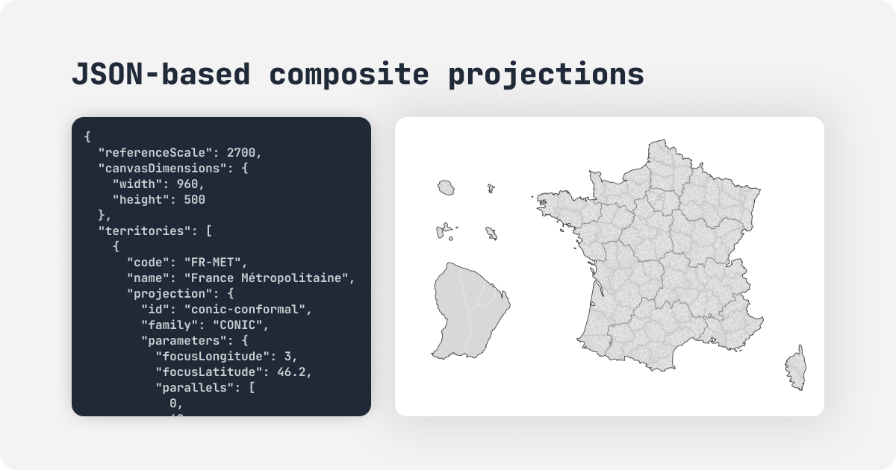

# Atlas Composer

> Interactive editor of composite map projections, with the libraries that draw its maps in other applications.

<p align="center">
  
</p>

[](LICENSE)   

A composite map brings distant territories together on one map, each with its own projection, scale and position. France with its overseas territories is an example. Atlas Composer is an editor of such maps and a set of npm packages that draw them.

## Editor

The [Atlas Composer editor](https://shallowred.github.io/atlas-composer) runs in the browser. In the editor, a person can:

- choose an atlas in the atlas menu, such as France with its overseas territories;
- display it as a custom composite, a ready-made composite projection, one map per territory or a single map;
- change the projections and their parameters and see the map update;
- move the territories of a custom composite on the map;
- export a custom composite as a JSON file, which another application draws with `@atlas-composer/projection-loader`.

## Running the editor locally

[AGENTS.md](AGENTS.md) describes the Node and pnpm versions. The editor reads the built files of the packages and the geographic data of an atlas, so these two steps come before the server:

```bash
pnpm install
pnpm build:packages
pnpm geodata:prepare france
pnpm dev
```

The server listens on http://localhost:5173. France is the default atlas. The command `pnpm geodata:prepare` takes one atlas of `configs/atlas-registry.json` at a time, and [docs/scripts.md](docs/scripts.md) describes its arguments.

## Packages

The packages of `packages/` are published on npm:

- [`@atlas-composer/projection-loader`](packages/projection-loader/) reads an exported file and returns a d3 projection.
- [`@atlas-composer/preset-library`](packages/preset-library/) publishes the presets of the editor, such as `france-standard`, and a catalog that describes them.
- [`@atlas-composer/specification`](packages/specification/) defines the format of the exported file, with a JSON Schema, TypeScript types and a validation function.
- [`@atlas-composer/projection-core`](packages/projection-core/) holds the functions that combine several d3 projections into one composite projection.

## Documentation

- [Architecture](docs/architecture.md): the layers of the code and the steps from an action to the rendering.
- [Atlases](docs/atlases.md): the registry, the configuration of an atlas and the procedure to add one.
- [Projections](docs/projections.md): the projection definitions and the positioning of a territory.
- [Presets](docs/presets.md): the preset types and the preset library.
- [Export and import](docs/export.md): the exported file and its import.
- [Mapping of the d3 composite parameters](docs/d3-to-atlas-parameter-mapping.md): the parameters of `d3-composite-projections` and those of a preset.
- [Geographic data scripts](docs/scripts.md): the preparation and the validation of the data.
- [Development](docs/development.md): the tests of the format and the rendering, the release and the debug logs.
- [Architecture decisions](docs/adrs.md): each decision and its reasons.

## Acknowledgments

Atlas Composer uses the work of two projects:

- [d3-geo](https://github.com/d3/d3-geo), by [Mike Bostock](https://github.com/mbostock). The stream multiplexing and the composition of projections in `@atlas-composer/projection-core` derive from `geoAlbersUsa`.
- [d3-composite-projections](https://github.com/rveciana/d3-composite-projections), by [Roger Veciana](https://github.com/rveciana), which applies the composite projection to several countries and provides ready-made composite projections to the editor.

[THIRD-PARTY-LICENSES.md](THIRD-PARTY-LICENSES.md) gives the license of each project.

## License

[MIT](LICENSE) © [ShallowRed](https://github.com/ShallowRed)
